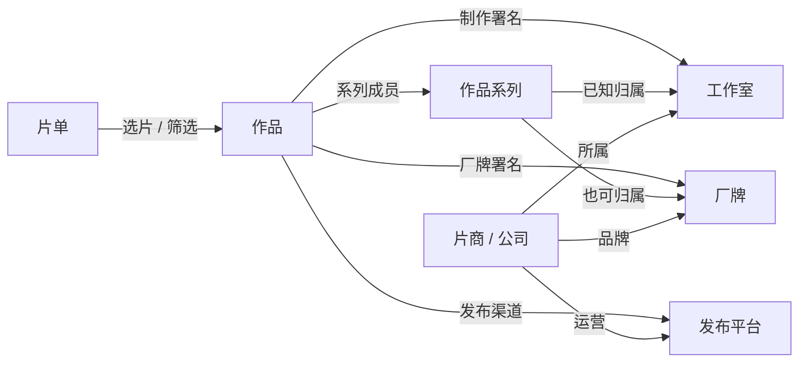

# 片库实体与归属关系

片商、工作室与系列不能作为同一层的合集类型。片商是经营或制作主体，工作室是制作单位，系列是一组作品的归属。机构的组织形态、在某部作品中的职责、作品之间的关系必须分别表达。

## 概念边界

| 概念 | 含义 | 与其它实体的关系 |
| --- | --- | --- |
| 片商 / 公司 | 制作或经营主体；来源只有 maker 时保留这一通用身份 | 可拥有工作室、厂牌、发布平台；作品分别记录制作、发行等职责 |
| 工作室 | 实际制作单位，可能独立，也可能隶属公司 | 通过已知的所属机构形成层级；不能仅凭字段名 `studio` 判定 |
| 厂牌 | 对外使用的品牌 | 可归属公司或工作室；品牌署名不等于实际制作方 |
| 发布平台 | 作品发布、分发的渠道 | 可记录运营机构；渠道名不等于系列，也不证明制作主体 |
| 系列 | 有正式名称的一组作品 | 独立系列档案，可记录归属机构；成员通过作品关系维护 |
| 片单 | 人工选片或保存的筛选规则 | 可以跨机构、跨系列；不修改作品正式归属 |
| 演员 / 导演 | 人物在作品中的演职员角色 | 人物不是标签，也不是机构；同一人物可承担多个角色 |
| 主题标签 | 描述题材、场景、偏好的词条 | 通过稳定标签 ID 与作品多对多关联，不承担机构或系列身份 |
| 作品分类 | 内容分区、类型、形式、原始对白语言、制作地区 | 独立维度，可与机构、系列和标签组合 |
| 年代 / 时长 / 状态 | 发行日期、时长、资产与播放绑定派生的信息 | 查询条件，不新增机构、系列或标签 |
| 媒体资产 / 片源版本 | 某个文件、分片、字幕、画质和播放时间轴 | 归属作品；相同作品不代表相同片源版本 |

## 层级与关系

图中的机构关系是可选关系，不要求每部作品都具有完整的“片商 → 工作室 → 厂牌 → 系列”链条。系列也可直接归属公司。没有来源依据时保持归属未知；不从同名、番号前缀或平台关键词推定关系。一个系列被某平台发布，也不自动证明该平台拥有系列。

机构所属关系拒绝循环，上级须为公司或工作室，厂牌与渠道不作为上级组织。按公司筛选会纳入已知所属机构的作品，并按作品 ID 去重。系列归属本身不产生制作或发行署名。

## 模型与兼容

- `catalog_series` 是系列正式档案，保存名称、别名、简介、已知归属及修订号；`catalog_work_series` 单独保存成员关系。字段同步与手工成员有独立来源，替换或清空作品的系列字段只更新字段同步的关系。
- `catalog_organizations` 保存机构资料与所属关系，`catalog_work_organizations` 保存作品职责。职责包括制作、发行、厂牌、平台和原始署名，不包含系列。
- 旧 `Collection` / `WorkCollection` 保留为兼容索引。`CollectionKind` 是旧接口枚举，不再作为领域分类依据；其中 `series` 条目只是独立系列的兼容投影。
- `Work.studio` 是历史字段名，表示来源的 maker / 制作方；不能据此把所有片商登记为工作室。新入库默认使用通用机构，只有已维护的工作室档案才复用工作室身份。`Work.label` 是厂牌，`Work.series` 是系列。
- 来源中的 maker、label、series 继续分别读取；名称包含平台词也不会把明确的系列改判为平台。外部原始字段与快照保留，规范档案改名保留旧名别名。

SQLite 首次初始化时在同一事务内迁移：保留原系列 ID、档案、成员、显式归属和修订号；把旧“系列职责”转为系列成员；旧自动生成、没有人工机构档案的 `studio` 记录恢复为通用机构，保留 ID。有同名通用机构时不强行合并。只清除能由现有作品字段确认、由系列关键词错误产生的平台关联，不删除平台档案。迁移有完成记录，重启不会覆盖后来编辑。

## API、筛选与 Skill

机构档案：`/api/catalog/organizations`；系列档案：`/api/catalog/series`。机构写接口不接受系列类型或系列职责；系列写接口不接受系列作为归属机构。两者分别维护版本号。

作品查询及动态片单分别使用 `organizations`、`labels`、`platforms`、`series` 的稳定 ID 数组。同维度任意匹配，不同维度同时匹配。返回的 facets 分开统计这四组；人物档案把合作机构与参演系列分开返回。Web 与 Media 使用相同契约。旧 `collection` 筛选、旧 `studio` 类型查询和保存于 `organizations` 的旧系列 ID 只在输入适配层兼容。

Skill 对应 `organizations.list/create/update/link` 与 `series.list/create/update/add`。查询先读取实际 ID；资料更新携带当前修订号。系列加入只维护成员，不新增制作或发行署名。新能力随服务版本发布，本地改代码不代表已部署服务已经支持。

作品详情、机构资料、系列资料、筛选、人物合作统计和片单应遵守以上边界，不能再把它们合并展示为同一种“合集”。
